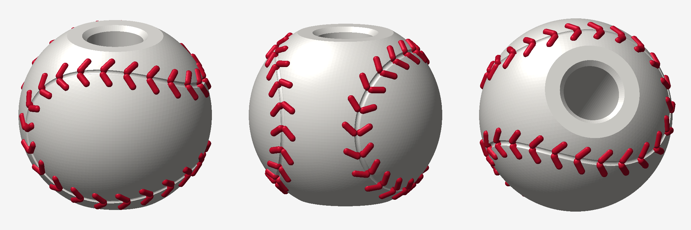

# Baseball Hoodie Bead

A baseball-shaped bead for hoodie drawstrings: a white ball with red V stitches.



**Size:** 24 mm ball (about 1 in), 20.8 mm tall, with a 7 mm drawstring hole.
The top and bottom are flat so it prints without supports.

## Which file to print

| Your printer | File | How |
|---|---|---|
| Multi-color (Bambu AMS, Prusa MMU, Creality CFS, tool changer) | `baseball_bead.3mf` | Opens as one object with two parts. Set **Red Stitches** to red filament and **White Ball** to white. |
| Multi-color, using STLs | `baseball_bead_white_ball.stl` + `baseball_bead_red_stitches.stl` | Load both at once. When the slicer asks whether to load them as a single object with multiple parts, choose **Yes**, then give each part its color. |
| Single color | `baseball_bead_single_color.stl` | Print in white. The stitches are raised 0.45 mm, so you can color them with a fine-tip red paint pen. |

## Print settings

- Place it flat side down, with the hole pointing up. It loads that way.
- No supports.
- Layer height: 0.12–0.16 mm makes the stitches look best.
- Add a **brim**, because the flat bottom is small.
- PLA works fine.

## Changing the size

- **Scale in the slicer:** the hole scales with the ball. For example, 110% gives a 26.4 mm ball with a 7.7 mm hole.
- **Change one dimension:** edit the numbers at the top of `make_baseball_bead.py`, such as `HOLE_DIAMETER` or `BALL_DIAMETER`, then rebuild:

  ```bash
  pip install numpy trimesh manifold3d
  python3 make_baseball_bead.py
  ```
