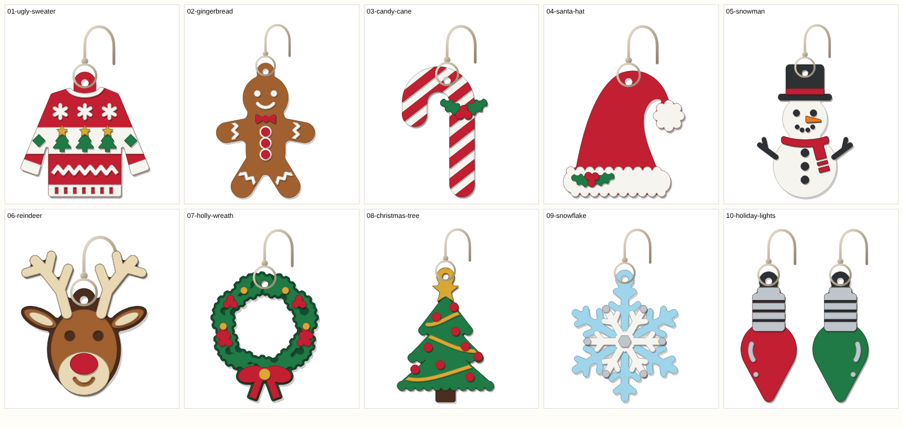

# Stocking Stuffer Earrings

Ten multicolor Christmas earrings, set up for the Snapmaker U1's four toolheads.



Each `.3mf` puts a left earring and a mirrored right earring on the plate. Every part is
already assigned to its toolhead (T1–T4), so you only have to load the right filaments.

| # | Design | File | Toolheads | Size |
|---|---|---|---|---|
| 01 | Ugly Christmas Sweater | `01-ugly-sweater/01-ugly-sweater.3mf` | T1 Santa red, T2 Snow white, T3 Holly green, T4 Gold | 28 × 27 × 3.0 mm |
| 02 | Gingerbread Cookie | `02-gingerbread/02-gingerbread.3mf` | T1 Santa red, T2 Snow white, T3 Gingerbread brown | 26 × 36 × 2.4 mm |
| 03 | Candy Cane | `03-candy-cane/03-candy-cane.3mf` | T1 Santa red, T2 Snow white, T3 Holly green | 19 × 30 × 3.0 mm |
| 04 | Santa Hat | `04-santa-hat/04-santa-hat.3mf` | T1 Santa red, T2 Snow white, T3 Holly green | 27 × 28 × 3.0 mm |
| 05 | Top-Hat Snowman | `05-snowman/05-snowman.3mf` | T1 Santa red, T2 Snow white, T3 Charcoal, T4 Carrot orange | 25 × 34 × 3.0 mm |
| 06 | Red-Nosed Reindeer | `06-reindeer/06-reindeer.3mf` | T1 Santa red, T2 Chocolate brown, T3 Gingerbread brown, T4 Antler cream | 25 × 28 × 3.0 mm |
| 07 | Holly Wreath | `07-holly-wreath/07-holly-wreath.3mf` | T1 Santa red, T2 Pine green, T3 Holly green, T4 Gold | 25 × 30 × 3.0 mm |
| 08 | Trimmed Tree | `08-christmas-tree/08-christmas-tree.3mf` | T1 Santa red, T2 Chocolate brown, T3 Holly green, T4 Gold | 25 × 35 × 3.0 mm |
| 09 | Layered Snowflake | `09-snowflake/09-snowflake.3mf` | T1 Ice blue, T2 Snow white, T3 Silver | 26 × 33 × 2.4 mm |
| 10 | Mismatched Holiday Lights | `10-holiday-lights/10-holiday-lights.3mf` | T1 Santa red, T2 Charcoal, T3 Holly green, T4 Silver | 13 × 31 × 2.4 mm |

The Mismatched Holiday Lights file prints a red bulb on the left and a green bulb on the right in the same job.

## Base loadout

Red (T1), white (T2), green (T3) and gold (T4) always use the same toolheads. With those
four loaded, the sweater, candy cane and Santa hat print with no spool swaps, and the other
designs need one to three swaps (listed in the table above).

## Printing on the Snapmaker U1

1. Open the `.3mf` in Snapmaker Orca. A left and a right earring land on the plate, each made of 3 or 4 parts.
2. Load the filaments listed for that design into T1–T4.
3. Slice and print face-up. No supports needed.

How the layers stack:

| Band | Height |
|---|---|
| 1 (base) | 0.0–1.2 mm |
| 2 | 1.2–1.8 mm |
| 3 | 1.8–2.4 mm |
| 4 | 2.4–3.0 mm |

Each band is a single color, so the toolhead only changes at band boundaries.

- **Layer height:** 0.2 mm and 0.12 mm both land exactly on the band boundaries.
- **Resizing:** scale X and Y only, so the bands keep their thickness.
- **Single-nozzle printer:** set every part to one filament, then add a color change at each band height.

## Finishing a pair

- **Hole:** each earring has a 1.8 mm hook hole.
- **Jump rings:** use open rings, 5–6 mm, 20–21 gauge.
- **Ear wires:** add French hook ear wires.

## Changing a design

Each design is drawn in `make_christmas_earrings.py` as 2D shapes, one region per color.
The script fills in material under every raised part, so nothing floats, then cuts the hook hole.
To change a design, edit its drawing in the script, then rebuild:

```bash
pip install numpy shapely trimesh mapbox_earcut
python3 make_christmas_earrings.py
```
