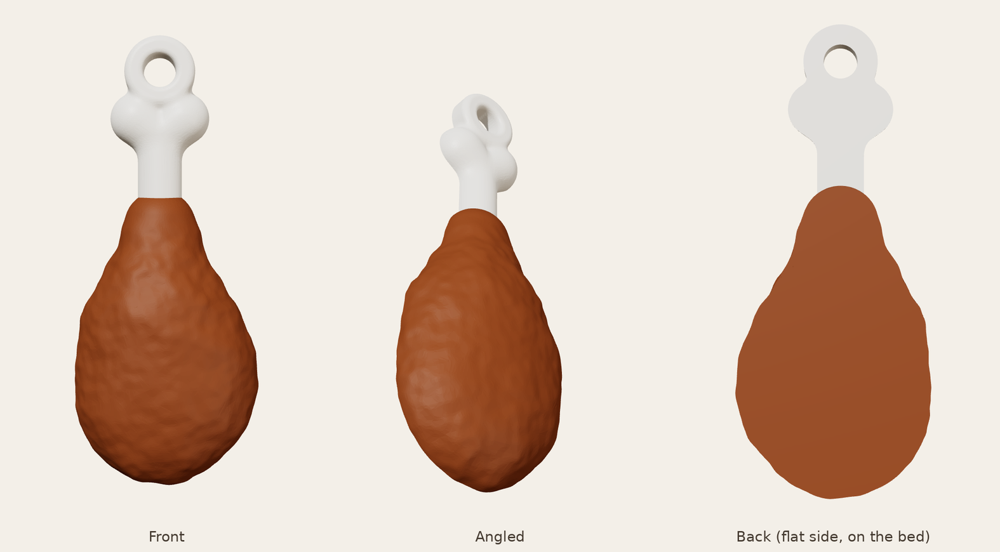

# Turkey Leg Earring

A cartoon turkey drumstick earring: brown roasted meat with a white bone and a
hanging loop at the top for a jump ring or ear wire.



**Size:** 18.4 mm wide, 44.7 mm long (about 1¾ in), 6.2 mm thick at the meat.
The loop is 7 mm across with a **3.0 mm hole** and is 2.3 mm thick.
Each earring weighs about 2 g or less in PLA.

The back is flat, so it prints flat on the bed with no supports. The front is
rounded, with a lumpy "roasted" skin texture on the meat.

## Which file to print

| Your printer | File | How |
|---|---|---|
| **Snapmaker U1** or another multi-color printer (Orca, Bambu Studio) | `turkey_leg_earring_pair.3mf` | Opens two earrings on the plate. Each is one object with two parts already assigned: **Bone (white)** to filament 1 and **Meat (brown)** to filament 2. Load white in slot 1 and brown in slot 2, or change the part colors in the object list. |
| Multi-color, using STLs | `turkey_leg_bone_white.stl` + `turkey_leg_meat_brown.stl` | Select both files and import them together. When the slicer asks whether to load them as a single object with multiple parts, choose **Yes**. Then set each part's filament. Right-click and choose Clone to make the second earring. |
| Single color | `turkey_leg_single_color.stl` | One solid piece. Print it in brown and paint the bone white, or the other way round. |

## Print settings (Snapmaker U1 / Snapmaker Orca)

- It loads flat side down. Leave it that way.
- No supports.
- Layer height: 0.12–0.16 mm gives the smoothest dome. 0.2 mm also works.
- 3 walls and 15–20% infill.
- PLA works fine. A brim is optional because the flat back gives plenty of bed contact.

The bone doesn't just touch the meat side by side. It runs about 9 mm into the
meat as a hidden tab, with brown above and below it, so the two colors are
locked together.

## Hanging it

Open a jump ring, pass it through the loop, hook it onto the ear wire's loop,
and close it. If the earring hangs sideways on your ear wire, add a second jump
ring. That turns it 90°.

## Changing the size

- **Scale in the slicer:** the hole scales with the earring. For example, 85% gives
  a 38 mm earring with a 2.55 mm hole.
- **Change one dimension:** edit the numbers at the top of
  `make_turkey_leg_earring.py`, such as `LOOP_HOLE_R`, `BULB_RADIUS_X` or
  `MEAT_LUMPS`. Then rebuild:

  ```bash
  pip install numpy scipy scikit-image trimesh manifold3d
  python3 make_turkey_leg_earring.py
  ```
